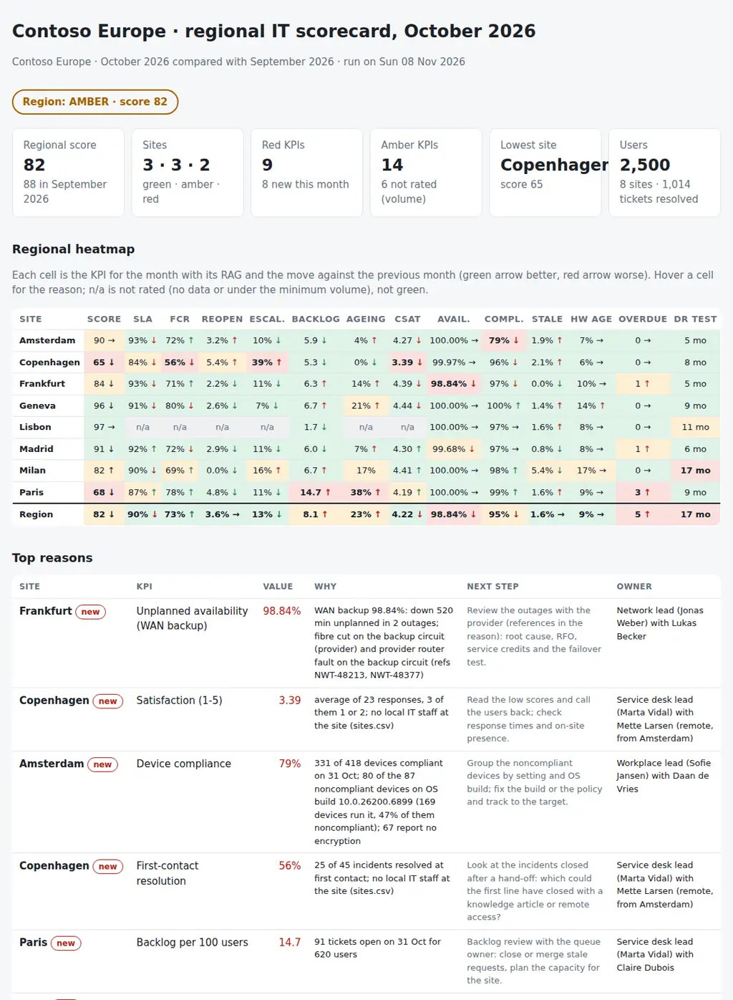

# Multi-Site IT Scorecard

The monthly scorecard of a regional IT lead: how is IT doing at each of our European offices this month, which site is slipping and why, and what do I take to the regional review? From the sites, the ITSM ticket export, the outage events of monitoring, the Intune device snapshots, the open actions and the DR/BCP tests, it puts together:

- **Service desk:** SLA attainment by priority, first-contact resolution, reopen and escalation rates, backlog per 100 users and its ageing, and satisfaction.
- **Availability:** WAN primary and backup, Wi-Fi, printing, meeting rooms and file and print per site, with only the unplanned minutes held against the target.
- **Devices:** compliance, stale check-ins and the share of hardware older than four years.
- **Follow-up:** overdue actions and how long ago each site tested its DR/BCP plan.
- **For every KPI:** a RAG status against its target and red threshold, *n/a* when the volume is too small to rate, the trend against the previous month and, for every red, the reason found in the data.

Six CSVs, one JSON with the targets and the weights, and one Python command give every site a score and a status (**GREEN**, **AMBER** or **RED**), a regional roll-up, and the pack for the regional review with one section per site and a decision column: **which site is slipping, on what, why, and who does what by the next review.**

Python 3.10+, standard library only. It runs with fictional demo data out of the box. A read-only PowerShell exporter for Intune (Microsoft Graph) and Jira Service Management is included.

It takes the ticket KPIs of [04-itsm-kpi-dashboard](https://github.com/inigogonzalezgarcia/04-itsm-kpi-dashboard) from one service desk to several offices side by side; when the service is delivered by a provider, [28-euc-provider-service-review](https://github.com/inigogonzalezgarcia/28-euc-provider-service-review) is the monthly review of their SLAs and OLAs.



## Why

Every office has its own story, and the monthly numbers rarely tell it on their own. In a typical month across eight offices:

- the backup circuit of one office is down twice for almost nine hours in total, nobody notices because the primary stays up, and the office would have been offline if the primary had failed that week;
- a fifth of an office's laptops fall out of compliance the week a new Windows 11 build reaches them, and most of those report no encryption;
- the smallest office has eight tickets in the month, and an SLA percentage on eight tickets would be green or red by chance;
- an office loses its only local engineer, and in the next month first-contact resolution drops from 79% to 56%, escalations to the central team go from 14% to 39% and satisfaction from 4.5 to 3.4;
- one office has not tested its DR plan for seventeen months;
- and the busiest office has 91 open tickets, 35 of them older than 30 days, three overdue actions and an SLA just under target.

The ITSM tool knows the tickets, monitoring knows the outages, Intune knows the devices, the tracker knows the actions and the BCP register knows the tests. The scorecard joins them by site and month, applies the same targets to every office, and writes down the reason behind each red. The rules are in `settings.json` and `sitescorecard/checks.py`.

## What it checks

| Area | Code | KPI | Default target, red | Minimum to rate |
|---|---|---|---|---|
| Service desk | SLA | SLA attainment of the tickets resolved in the month, with the breakdown by priority | ≥ 90%, red < 80% | 20 resolved tickets |
| Service desk | FCR | Incidents resolved at first contact | ≥ 70%, red < 60% | 15 resolved incidents |
| Service desk | REO | Resolved tickets reopened | ≤ 5%, red > 10% | 20 resolved tickets |
| Service desk | ESC | Resolved tickets escalated to the central team | ≤ 15%, red > 25% | 20 resolved tickets |
| Service desk | BKL | Tickets open at the month end per 100 users | ≤ 7, red > 10 | |
| Service desk | AGE | Share of the backlog older than `ageing_days`, with the ageing buckets and the oldest ticket | ≤ 15%, red > 25% | 10 open tickets |
| Service desk | CSAT | Average satisfaction (1-5) | ≥ 4.2, red < 3.8 | 10 responses |
| Availability | AVL | Unplanned availability per service, 24x7; the site takes its worst service | per service (WAN primary 99.9%, WAN backup 99.5%…), red 0.5 points below | |
| Devices | CMP | Intune compliance in the last snapshot of the month, with the OS build behind most failures | ≥ 95%, red < 90% | 20 devices |
| Devices | STL | Devices with no check-in for more than `stale_days` | ≤ 3%, red > 8% | 20 devices |
| Devices | HWA | Devices older than `hardware_years` | ≤ 15%, red > 25% | 20 devices |
| Follow-up | ACT | Actions open at the month end past their due date | 0, red > 2 | |
| Follow-up | DRT | Months since the last DR/BCP test; failed is red, partial or due within `dr_warning_days` is amber | ≤ 12 months | |

Under its minimum volume a KPI is *n/a*: not rated and never green, read ticket by ticket instead. The site score is the weighted share of points (green 100, amber 50, red 0) over the rated KPIs, with the weights in `settings.json`; a site is green from 85, amber from 70 and red below, and a site with a red KPI is never green. The regional row pools tickets and devices, shows the worst site for availability and the worst status for actions and DR tests, so that one site's outage is not averaged away; the regional score is the average of the sites weighted by users.

## Outputs

| File | What |
|---|---|
| `report.html` | Regional status, tiles (regional score, sites by status, red and amber KPIs, lowest site, users), the heatmap of sites by KPI with the trend arrows (hover a cell for the reason), the top reasons, a card per site and all findings |
| `regional-review-pack.md` | The pack for the regional review: decisions per site with a proposal and a decision column, headlines, scope and evidence, the heatmap, one section per site with every KPI, its target and reason, and the decisions with owners; actions, notes and sign-off |
| `site-scorecard.csv` | One row per site and the region: score, previous score, status, counts of red, amber, green and not rated, and the value and status of every KPI |
| `kpi-detail.csv` | Every KPI of every site with numerator, denominator, target, red threshold, previous value, trend, weight and reason, plus the detail rows: SLA per priority, availability per service, ageing buckets |
| `trend.csv` | The value and status of every KPI and the score for both months; append it each month for a longer history |
| `actions.csv`, `findings.csv` | Reds and worsening ambers with owner, due date and a decision column; and every red, amber and not-rated KPI with its reason and next step |

## Try it

```bash
git clone https://github.com/inigogonzalezgarcia/47-multi-site-it-scorecard.git
cd 47-multi-site-it-scorecard
python -m sitescorecard demo
```

Open `output/report.html` and `output/regional-review-pack.md`.

### The demo data

The demo is a made-up professional services company, Contoso Europe, with 2,500 people in eight offices: Madrid, Paris, Amsterdam, Copenhagen, Frankfurt, Geneva, Milan and Lisbon. The scorecard covers October 2026 against September 2026 and is run on Sunday 8 November:

- 2,365 tickets created since 1 September, plus the older ones still open; 78 outage and maintenance events; two Intune snapshots (30 September and 31 October) of 2,550 laptops each; 16 projects and actions; the DR test register.

Everything is fictional: people, tickets, devices, circuits and provider references. The problems are placed on purpose among the everyday ones:

- **Frankfurt:** the WAN backup circuit down 520 minutes unplanned in two outages (a fibre cut and a provider router fault, with the provider tickets), 98.84% against 99.5%; the planned upgrade of the primary circuit is listed but not held against the target.
- **Amsterdam:** compliance from 98% to 79% after the Windows 11 25H2 build (10.0.26200) reached 169 laptops: 80 of the 87 noncompliant devices run it, 67 report no encryption.
- **Lisbon:** 60 users and eight resolved tickets: SLA, FCR, reopen, escalation, ageing and CSAT are *n/a*, not green; the DR test is due within a month.
- **Copenhagen:** no local IT staff since the end of September; FCR from 79% to 56%, escalations from 14% to 39%, satisfaction from 4.48 to 3.39, SLA down to 84%.
- **Milan:** the last DR test in June 2025, 17 months ago; stale check-ins and old laptops amber.
- **Paris:** the busiest office, 14.7 open tickets per 100 users, 35 of 91 older than 30 days (the oldest from July), three overdue actions and SLA at 87%.

The result: the region **AMBER** at 82 (88 in September); Madrid, Geneva and Lisbon green, Amsterdam, Frankfurt and Milan amber, **Copenhagen (65) and Paris (68) red**; 9 red KPIs, 8 of them new this month, 14 amber and 6 not rated.

## Use it with your own data

1. Export (read-only):
   ```powershell
   .\scripts\Export-SiteScorecardData.ps1 -OutputFolder .\data -SiteFromDeviceName -Append `
       -JiraSite https://contoso.atlassian.net -Project ITSD -SiteField customfield_10120 -SlaField customfield_10030 -SatisfactionField customfield_10031
   ```
   - Microsoft Graph PowerShell: `Get-MgDeviceManagementManagedDevice -All -Property …` (compliance state, OS version, encryption, last sync, enrolment date) with the read scope `DeviceManagementManagedDevices.Read.All`, and the site from the device name or the primary user's office (`Get-MgUser`). With `-Append` the file keeps one snapshot per month.
   - Jira Cloud REST API: `GET /rest/api/3/search/jql` with `nextPageToken` paging, the SLA field of Jira Service Management (breached cycles), the Satisfaction field, and FCR, reopened and escalated from labels set by your automation rules. Credentials come from `Get-Credential` and are never written to disk.
2. Add `availability.csv` from your monitoring tool (the Zabbix availability report or problem history, SolarWinds availability or event reports), `sites.csv`, and if you keep them, `projects.csv` and `dr_tests.csv`. Adjust `data/settings.json`: the report month, targets, minimum volumes, availability targets per service, weights and owners ([docs/data-format.md](docs/data-format.md) has every column and setting).
3. Build the outputs:
   ```bash
   python -m sitescorecard review data/ --month 2026-10
   ```

[docs/regional-review.md](docs/regional-review.md) has the monthly cycle, the agenda of the regional review, how to read RAG and trends, what to do with each red, how targets are set and how to keep the KPIs from being gamed.

The exports contain ticket keys, device names and user-related data. Keep them inside your organisation:

- real files at the top level (`sites*.csv`, `tickets*.csv`, `availability*.csv`, `devices*.csv`, `projects*.csv`, `dr_tests*.csv`, `settings.json`, `data/`, `downloads/`) and the `output/` folder are excluded from Git by `.gitignore`;
- only the fictional files in `sample_data/` are committed.

## Tests

```bash
pip install -r requirements-dev.txt
python -m pytest -q
```

GitHub Actions runs them on Python 3.10 and 3.12 on every push, then rebuilds the fictional sample data and the report screenshot from the simulator.

14 tests: loading sites, tickets, outages and devices with export column names (Jira dates with time zones, Intune compliance states, purchase dates); SLA with its RAG and breakdown by priority; minimum volumes giving *n/a*, not green; FCR, escalation, reopen and CSAT with the no-local-staff reason; backlog and ageing at the month end; availability with unplanned minutes only, per service, with references; device compliance with the OS build, encryption, stale check-ins and age; overdue actions and DR test freshness; trend, score and site status; settings overrides; the regional roll-up; the pack and the CSVs; missing files and unrated sites; and the demo end to end (deterministic, all seven outputs, every planted finding).

## Next steps

- Run it on the first working day of every month and keep `trend.csv` to show twelve months per site.
- Read the outages straight from the Zabbix API (`event.get` with the problem and recovery events) instead of a report export.
- Add the OLA of the central team next to the site SLAs, so an escalation shows where its time went.
- Weight availability by business hours per site time zone, next to the 24x7 figure.
- Add capacity per site (WAN utilisation, Wi-Fi clients per access point) from Grafana.

## Background

Built from my work leading IT across offices:

- IT site leader at a multi-site financial services company: leading one office's IT with two engineers and supporting around 2,500 users across European offices, in an office that grew from about 15 to over 120 people;
- defining and tracking SLAs and OLAs; availability and capacity management as a formal practice, with metrics, trends and plans; process dashboards; backlog, quality and ageing of tickets and escalations, with offshore teams;
- managing connectivity, hardware and service vendors, and supervising DR/BCP tests; Device42 for the comms-room inventory;
- Intune for Windows, macOS, iOS and Android, MECM/SCCM packaging, and leading a Windows 11 migration;
- Zabbix, SolarWinds, Grafana and ELK for monitoring; PowerShell and Python; Jira Service Management and Confluence.

Written from scratch with fictional data; no employer data, systems or exports are used.

## Customisation and contact

Want this adapted to your environment? For example:

- your sites, targets, minimum volumes and weights;
- your ITSM tool (ServiceNow, Freshservice, GLPI) and its SLA fields;
- your monitoring tool's availability export and your list of services;
- the pack in the format of your regional or management review.

Get in touch:

- Website (contact form): [inigogonzalezgarcia.github.io](https://inigogonzalezgarcia.github.io/about.html#contacto)
- LinkedIn: [linkedin.com/in/igonzalez93](https://www.linkedin.com/in/igonzalez93)

## License

MIT
